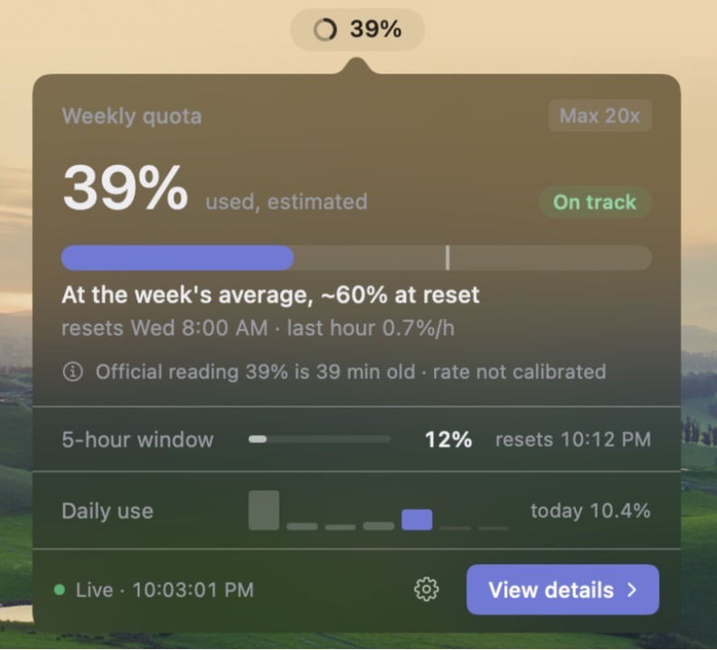
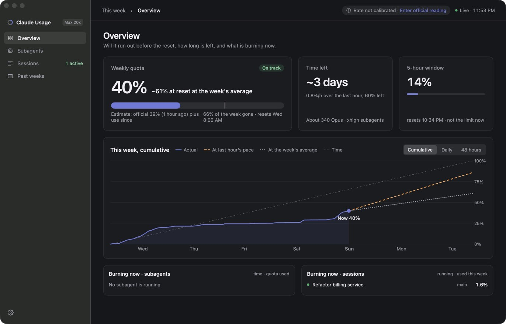
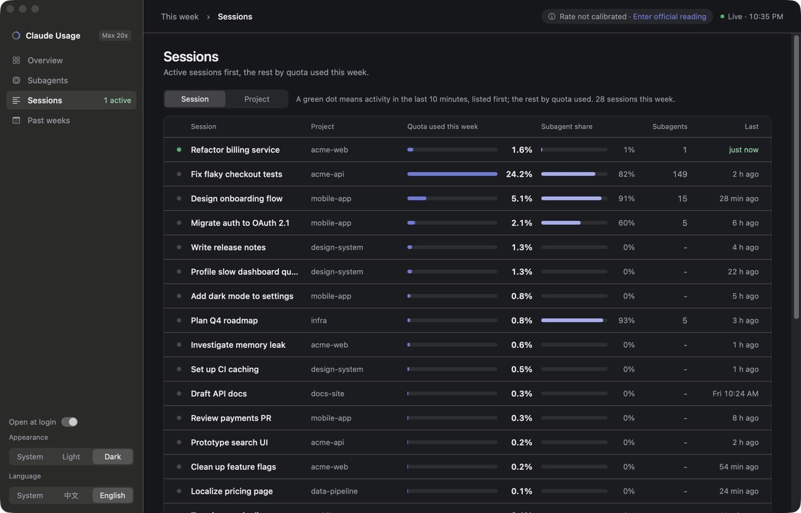
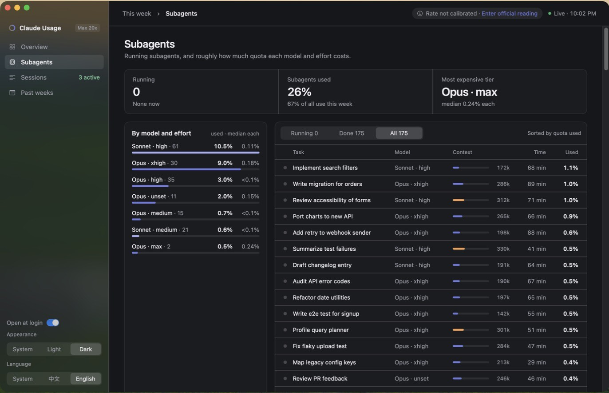
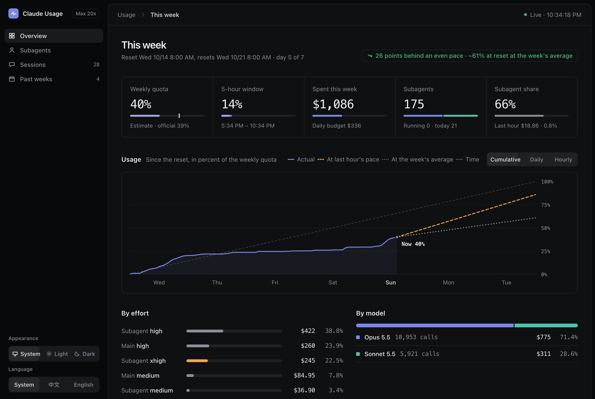

<p align="center">
  
</p>

<h1 align="center">Claude usage monitor</h1>

<p align="center">
  See how much of your Claude weekly limit you have used, whether it will last until the reset, and which sessions and subagents are spending it.
</p>

<p align="center">
  English · <a href="README.zh-CN.md">简体中文</a>
</p>

A local, live dashboard of Claude Code usage on a Mac.
It tails Claude Code's transcripts into a SQLite store, reads the Claude app's sampled plan-usage meter, and serves a page at http://127.0.0.1:8765 that refreshes every 5 seconds.
A native menu bar app runs it for you and shows the same numbers.

Everything stays on your Mac: it reads local files, binds to 127.0.0.1 only, and never reads credentials.
It is an unofficial tool, not made by or affiliated with Anthropic.

<p align="center">
  
</p>



<table>
  <tr>
    <td></td>
    <td></td>
  </tr>
</table>

The same numbers are on a web page at http://127.0.0.1:8765, in English or Chinese:



The screenshots use made-up session and project names.

## The menu bar app

`macos/` is a native macOS app, Claude Usage, that runs the monitor for you.
It starts at login, shows the weekly percentage in the menu bar, opens a small summary when the pointer rests on it, and opens the full dashboard in a window from "View details".
It sends a notification once a week when the pace would fill the limit before the reset, and at 80% and 95%.

```sh
macos/build-app.sh --install   # build, install to ~/Applications and open it
```

It needs the Xcode command line tools to build and `/usr/bin/python3` to run, since it runs the bundled `monitor.py`.
It keeps its own `state.db` in `~/Library/Application Support/Claude Usage/`; the first install copies the one next to `monitor.py` there.
If a monitor of the current version already answers on port 8765, it uses that one instead of starting its own.

## Run without the app

```sh
./install.sh      # start now and at every login (launchd agent)
./uninstall.sh    # stop and remove the agent; state.db stays
python3 monitor.py          # run in the foreground instead
python3 monitor.py --once   # scan once and print the meter estimates
```

Standard library only; Python 3.10 or later.

## What it shows

- Weekly and 5-hour limits: the app's last official reading, plus an estimate for spend since then, and when the current pace would reach 100%.
- Spend in the last hour, today and this limit window, and the share spent by subagents.
- This week's cumulative use against time, with where the last hour's pace and the week's average would take it, daily and hourly spend by model family, and this window's spend by model and by effort.
- Every subagent this window, active ones first, with model, effort, calls, current context size and spend, and the median a subagent of each model and effort costs.
- Every session this week, active ones first, alone or grouped by project, and the last eight weeks side by side.

A weekly reading copied from claude.ai by hand ("Enter official reading" in the app) counts like one the Claude app sampled.

How the numbers are worked out is in [docs/README.md](docs/README.md).

## License

[MIT](LICENSE)
