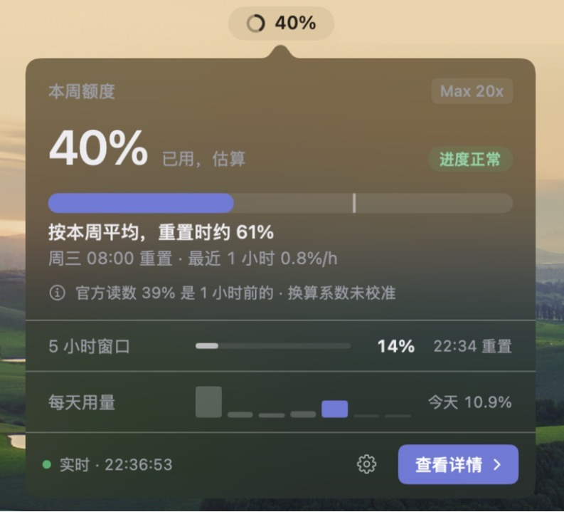
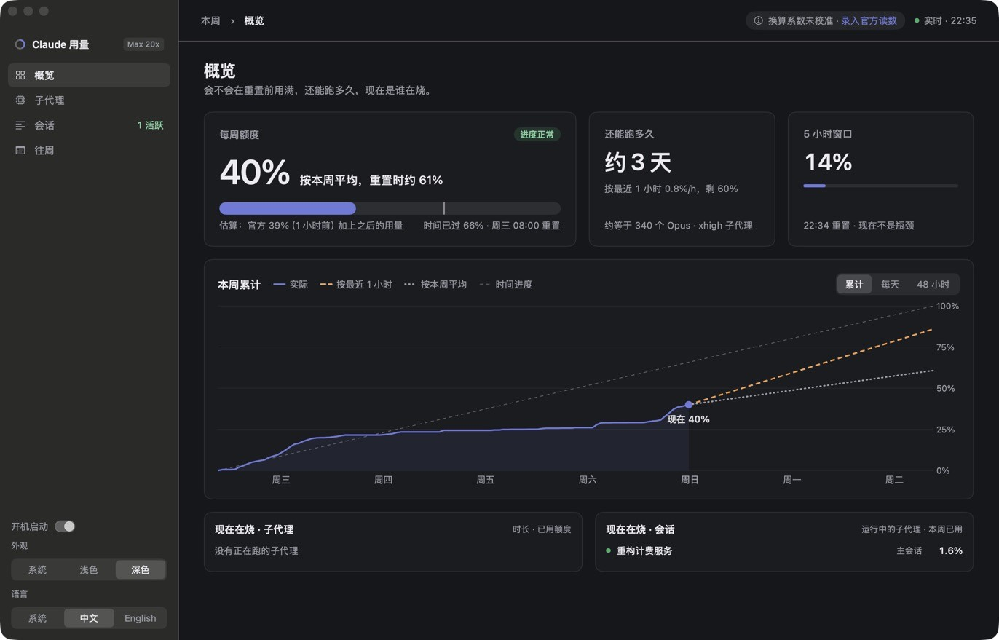
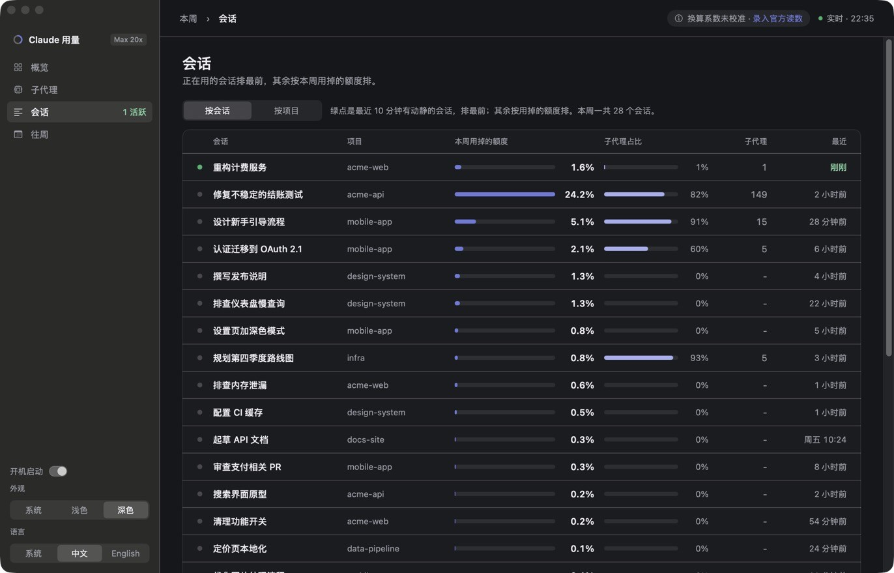
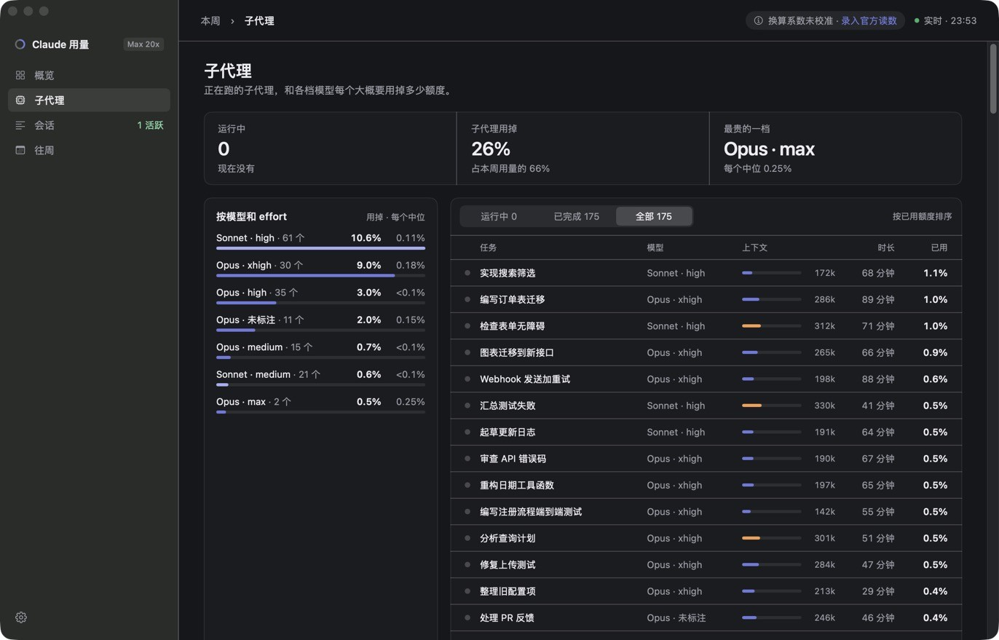
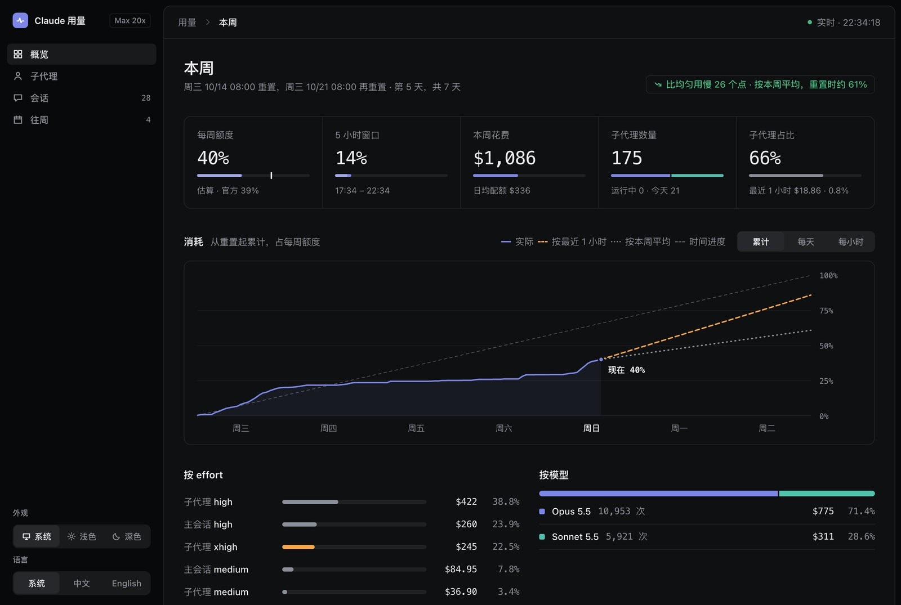

<p align="center">
  
</p>

<h1 align="center">Claude 用量监控</h1>

<p align="center">
  看看 Claude 每周额度用了多少，能不能撑到重置，以及是哪些会话和子代理在用。
</p>

<p align="center">
  <a href="README.md">English</a> · 简体中文
</p>

一个在 Mac 本地运行、实时更新的 Claude Code 用量面板。
它把 Claude Code 的会话记录读进一个 SQLite 数据库，读取 Claude app 采样的官方额度读数，并在 http://127.0.0.1:8765 提供一个每 5 秒刷新的网页。
另有一个原生菜单栏 app 替你运行它，显示同样的数字。

所有数据都留在你的 Mac 上：它只读本地文件和进程统计，只监听 127.0.0.1，从不读取任何凭据。
这是一个非官方工具，与 Anthropic 无关，也不是 Anthropic 出品。

<p align="center">
  
</p>



<table>
  <tr>
    <td></td>
    <td></td>
  </tr>
</table>

同样的数字也可以在网页 http://127.0.0.1:8765 上看，网页同样支持中文和英文：



截图里的会话名和项目名都是编的。

## 菜单栏 app

`macos/` 是一个原生 macOS app，叫 Claude 用量（Claude Usage），它替你运行监控服务。
它开机自动启动，在菜单栏显示每周额度的百分比，鼠标停在上面时弹出一个小面板，点“查看详情”打开完整的面板窗口。
如果按现在的速度会在重置前用满，它每周提醒一次，用到 80% 和 95% 时也会提醒。
界面支持中文和英文，可以在面板窗口左下角切换。

```sh
macos/build-app.sh --install   # 构建，安装到 ~/Applications 并打开
```

构建需要 Xcode 命令行工具，运行需要 `/usr/bin/python3`，因为它运行的是打包进去的 `monitor.py`。
它把自己的 `state.db` 放在 `~/Library/Application Support/Claude Usage/`；第一次安装时会把 `monitor.py` 旁边的那份复制过去。
如果 8765 端口上已经有一个同版本的监控服务在运行，它会直接用那个，不再自己启动。

## 不用 app 运行

```sh
./install.sh      # 现在启动，并且每次登录时启动（launchd agent）
./uninstall.sh    # 停止并移除 agent；state.db 会保留
python3 monitor.py          # 改为在前台运行
python3 monitor.py --once   # 扫描一次，打印额度估算
```

只用标准库；需要 Python 3.10 或更高版本。

## 能看到什么

- 每周和 5 小时额度：Claude app 最近一次的官方读数，加上之后花费的估算，以及按现在的速度什么时候到 100%。
- 最近 1 小时、今天和本额度周期的花费，以及其中子代理花掉的比例。
- 本周累计用量和时间进度的对比，附按最近 1 小时速度和按本周平均推算的走势；每天和每小时按模型系列的花费；本周期按模型和按 effort 的花费。
- 本周期的每个子代理，正在运行的排最前，显示模型、effort、调用次数、当前上下文大小和花费，以及每种模型和 effort 的子代理花费中位数。
- 本周的每个会话，正在用的排最前，可以单独看或按项目分组；点开会话能看到它的子代理，以及每个是否还在运行。还有最近八周的对比。
- 每个正在跑的会话占用了多少本机 CPU 和内存，拆分到子代理的 worktree 和它跑的命令，旁边是 Claude app 本身。

从 claude.ai 手动抄来的每周读数（app 里的“录入官方读数”）和 Claude app 采样的读数一样算数。

数字是怎么算出来的，见 [docs/README.md](docs/README.md)（英文）。

## 许可证

[MIT](LICENSE)
